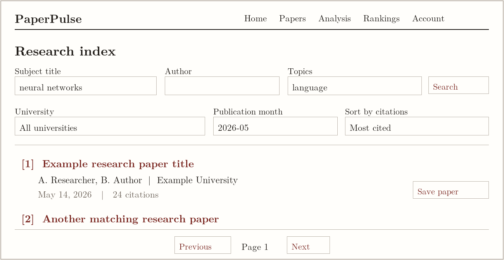
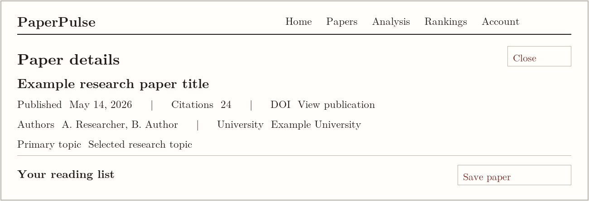
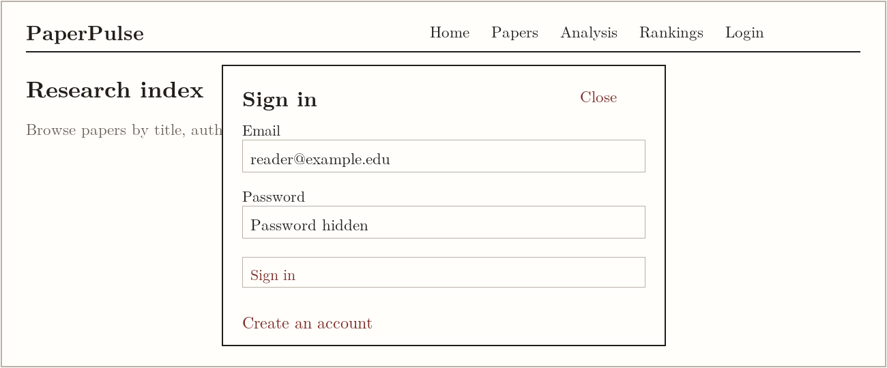
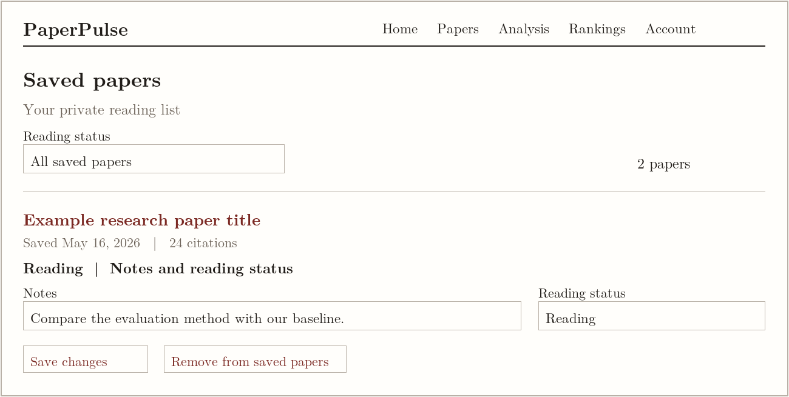
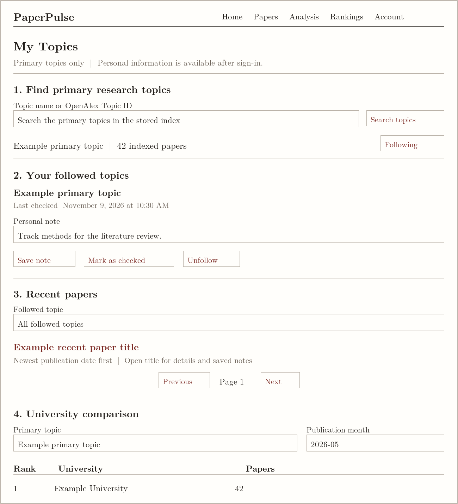
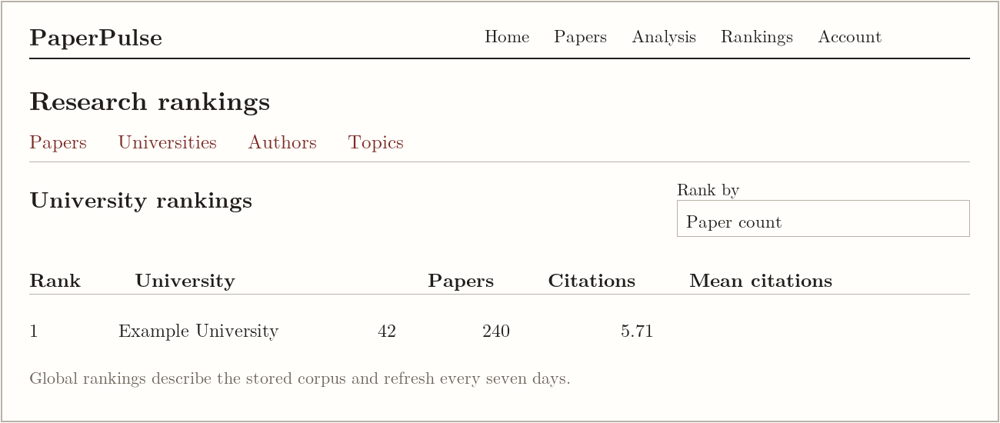

# PaperPulse Design Document

**CS5610 Project 3**

Sheng Qin and Tian Yuan

## 1 Project description

PaperPulse helps students and researchers discover university research, maintain a private reading list, and follow research interests. The application focuses on 2026 publications associated with universities in the United States or Canada. We use stored OpenAlex records to make papers searchable by title, author, topic, university, and publication month.

Our design connects discovery with continuing research work. A reader can find a paper, inspect its details, save it with notes, and track reading progress. A researcher can follow primary research topics, review recent publications, record when a topic was last checked, and compare university publication activity within a selected topic and month.

### Project scope

Public pages provide paper discovery, research analysis, and global rankings. Registration and sign-in enable private saved papers and My Topics. PaperPulse is an index and research organizer; publication links lead to the original source. Abstracts and full-text reading are outside the current index.

### Technology and interaction model

The client uses React with Hooks, Vite, HTML5, CSS3, and the native Fetch API. A Node.js and Express backend exposes JSON APIs. MongoDB is accessed through its native Node.js driver. Passport provides authentication, with sessions stored in MongoDB. Charts use SVG rather than a separate chart framework.

### Team responsibilities

| Team member | Primary responsibility |
| --- | --- |
| Sheng Qin | Paper browsing and combined search; university and month filters; paper details; saved-paper CRUD; corresponding routes and React components. |
| Tian Yuan | Research category tracking; followed-topic CRUD; recent papers; topic and month university comparisons; corresponding routes and React components. |

Analysis and global Rankings provide supporting views of the stored research corpus. My Topics complements these views with a signed-in reader's research interests.

## 2 User personas

These fictional personas translate the project proposal into concrete needs and workflows. They guide feature priorities and interface decisions.

### Alex the graduate student

Alex is preparing a literature review and needs to compare research from several universities. Alex works in short reading sessions, often revisits the same papers, and needs an organized way to remember what has already been read.

Goal. Find relevant papers efficiently and maintain a reliable reading list with useful notes.

Pain points. Search results can be broad, useful papers are easy to lose, and bookmarks do not capture reading status or research observations.

Typical session. Alex searches a title keyword and author, narrows results to a university and month, opens a paper, and saves it. After reading, Alex changes its status from Unread to Reading or Read and updates the notes.

Design implications. Combine search fields and filters, show publication and citation context, keep paper details close to the list, and make saved-paper editing explicit and private.

### Sarah the researcher

Sarah follows several research areas and periodically checks for new publications. Sarah also wants to understand which universities are active in a topic during a particular month, without repeatedly rebuilding the same search.

Goal. Maintain research interests, review recent publications, and compare university activity using a consistent topic definition.

Pain points. Repeated searches take time, similar topic names can be confusing, and it is difficult to remember when each area was last reviewed.

Typical session. Sarah signs in, follows a topic, adds a note about its relevance, reviews the recent-paper list, and marks the topic as checked. Sarah then chooses a month to compare university paper counts.

Design implications. Identify topics by stable OpenAlex IDs, keep followed interests in one account page, sort recent papers by publication date, and show an explicit last-checked timestamp.

### Access needs shared by both personas

Both readers need labeled controls, keyboard access, clear loading and empty states, recoverable request errors, and predictable pagination. Public discovery should remain available before sign-in; private work should remain attached to the authenticated account.

## 3 Paper discovery and saved paper stories

Owner: Sheng Qin. Each story includes a research situation and observable completion conditions.

### US1 Find relevant research

As Alex, I want to browse and search papers by title, author, university, research category, and publication date so I can find papers relevant to my research.

Scenario. Before a literature-review meeting, Alex remembers a topic and part of an author name. Alex enters both, chooses a university and publication month, and reviews the matching papers without discarding the other search criteria.

- Filled search fields and university/month filters are combined; clearing filters restores browsing.
- Results show titles, authors, university affiliations, publication dates, and citation counts, with 20 papers per page.
- Selecting a title opens paper details without requiring account creation.

### US2 Inspect a university and month

As Alex, I want to view papers from a selected university in a specific month and sort by current cumulative citations so I can prioritize papers to inspect.

Scenario. Alex is comparing recent work from one institution. Alex chooses May 2026, orders matching papers from most cited to least cited, and opens a title to check its authors, topic, DOI, and publication link.

- The selected university and month constrain the displayed papers.
- Citations can be sorted in ascending or descending order with stable ordering for ties.
- The interface explains that citation counts are cumulative stored counts, not citations received in the selected month.

### US3 Maintain a private reading list

As Alex, I want to save papers, add notes, update reading status, and remove saved papers so I can manage my literature review.

Scenario. Alex signs in and saves a useful paper. After reading its methods section, Alex adds a note and changes the status to Reading. Alex later marks it Read or removes it when it no longer belongs in the review.

- Signed-in readers can create, view, update, and delete their own saved-paper records.
- Reading states are Unread, Reading, and Read; repeated saves preserve the existing record.
- Notes remain private, removal requires confirmation, and stale edits prompt a reload rather than silently overwriting newer changes.

## 4 Research category tracker stories

Owner: Tian Yuan. My Topics groups the following tasks within the Account menu.

### US4 Manage followed topics

As Sarah, I want to follow research categories and view, update, or remove them so I can manage my research interests.

Scenario. Sarah starts a new project, signs in, and searches the stored primary-topic directory. Sarah follows a relevant topic and adds a personal note about its role in the project. When the project changes, Sarah edits the note or unfollows the topic.

- Only primary topics that exist in the stored papers can be followed; normalized OpenAlex Topic IDs define identity.
- Each account can follow a topic once, including when concurrent follow requests arrive.
- Followed-topic create, read, update, and delete operations belong to the authenticated user; another account cannot access or change them.

### US5 Review recent publications

As Sarah, I want to view recently published papers in followed categories and record when I last checked them so I can track my review activity.

Scenario. During a weekly review, Sarah opens My Topics and selects one followed topic. Sarah browses its newest publications, opens a title for details, and saves a useful paper. After the review, Sarah selects Mark as checked on that topic.

- The feed supports all followed topics or one selected followed topic, with 20 papers per page.
- Papers sort by publicationDate descending, then openAlexId descending for stable ties.
- The server records lastCheckedAt when Sarah explicitly marks a topic as checked; the interface displays it as a review time, not an import time or proof that every paper was read.

### US6 Compare university activity

As Sarah, I want to compare universities by paper count for a selected category and month so I can explore research activity across institutions.

Scenario. Sarah selects a followed primary topic and May 2026. The comparison shows which universities have more matching papers. Sarah changes the month or topic to inspect a different research context.

- The backend filters real stored papers by primary topic and a UTC calendar-month range before calculating university counts.
- Each paper counts once for a given university; a collaborative paper may count once for each participating university.
- The table orders universities by paper count, shows equal ranks for ties, and explains that counts describe the stored index rather than research quality.

## 5 Paper discovery mockups

The interface uses a restrained academic-paper layout: serif typography, a warm paper background, thin rules, and a muted red accent for actions and links. These annotated mockups use illustrative records and counts, not measured research results.

*Figure 1  Paper discovery with combined search, university and month filters, citation ordering, and pagination.*

*Figure 2  Paper details dialog with publication context, source links, and access to saved-paper controls.*

Interaction. Search submits text fields together. Changing a filter resets pagination. A paper title opens a dialog; closing it returns the reader to the list. Unauthenticated readers can inspect public details, while saving opens the existing sign-in flow.

Story coverage. Figure 1 supports US1 and US2. Figure 2 bridges discovery and the private reading-list workflow in US3.

## 6 Authentication and reading list mockups

Authentication is an overlay on the current page, so readers can sign in without leaving their research context. The account menu exposes My Topics, Saved papers, Settings, and Sign out.

*Figure 3  Sign-in dialog with registration entry point. Password content is never displayed as plain text.*

*Figure 4  Saved-paper editing with a private note, reading status, save action, and explicit removal action.*

Interaction. Saved papers offers reading-status filtering and 20-record pagination. A paper entry expands to edit its note and status. Remove opens a confirmation before deleting the saved record and its notes. Sign out has a separate confirmation dialog.

States. A signed-out reader sees a sign-in prompt. Loading, empty-list, request-failure, and retry messages occupy the same content area. On a stale edit, the reader is asked to reload the saved record before editing again.

## 7 My Topics mockup

After sign-in, readers reach this page through Account and then My Topics. Following at least one topic reveals Recent papers and University comparison. All sample names and counts below are illustrative.

*Figure 5  My Topics combines topic discovery, personal follow management, recent papers, and topic/month university comparison.*

Story coverage. Sections 1 and 2 support US4. Section 3 and Mark as checked support US5. Section 4 supports US6. Paper titles reuse the existing details and saved-paper controls.

## 8 Navigation and interaction design

Public navigation remains Home, Papers, Analysis, and Rankings. The Account menu contains My Topics, Saved papers, Settings, and Sign out. No additional top-level navigation is required for topic tracking.

*Figure 6  The existing global Rankings view stays separate from the filtered university comparison inside My Topics.*

### Consistent definitions

Analysis, global topic rankings, and My Topics use primaryTopic.id for topic statistics. Papers retains its original text search across primary and secondary topic names. Topic names are display labels; OpenAlex Topic IDs identify followed interests.

Publication dates determine recent-paper ordering and calendar-month comparisons. lastCheckedAt records the server time of a deliberate check action. syncedAt describes synchronization metadata and is not presented as the first time a paper entered the database. Mark as checked does not create a per-paper unread status.

### Privacy and data design

The main collections are papers, users, sessions, savedPapers, and followedTopics. A followed topic stores userId, topicId, note, lastCheckedAt, createdAt, and updatedAt, with a unique userId/topicId index. The server derives ownership from the Passport session and validates all personal writes. Personal responses use private, no-store and are not saved to localStorage.

### Refresh and feedback

Public topic-directory and university-comparison snapshots refresh every seven days from stored MongoDB data. Comparison cache keys include the selected topic and month. Refreshing a snapshot does not fetch new OpenAlex papers. Personal follow and note changes update the page immediately.

Each data view provides loading, empty, and failed-request states with retry controls. Login expiration returns the reader to sign-in. Semantic buttons, labeled fields, native dialogs, table headers, and visible keyboard focus support predictable interaction.
