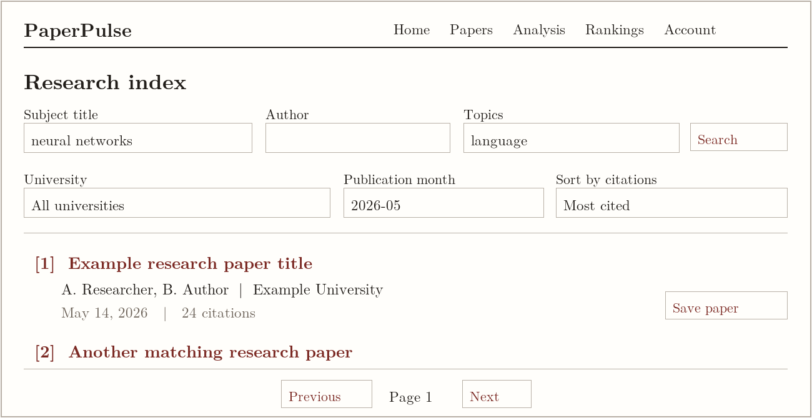
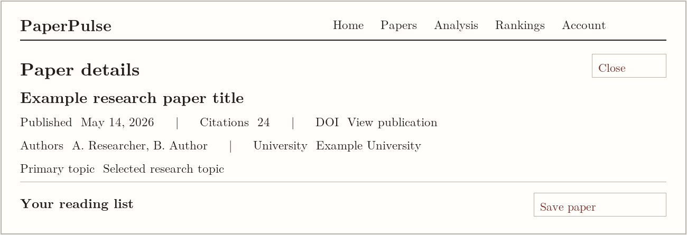
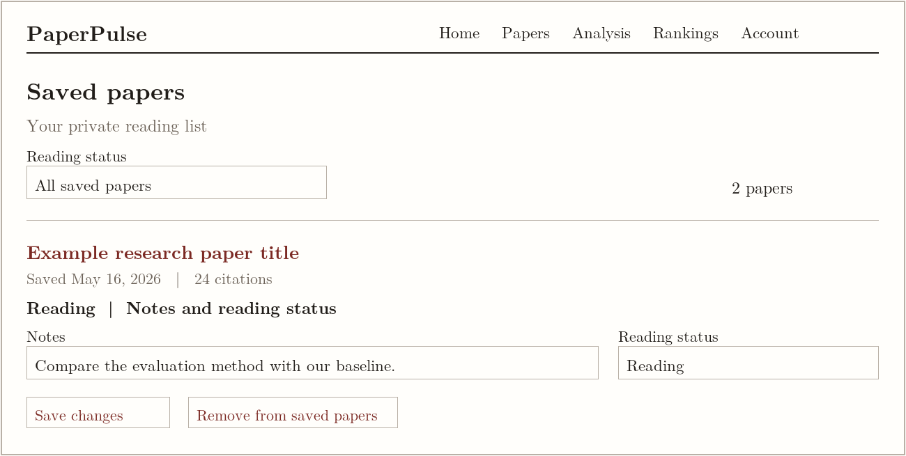
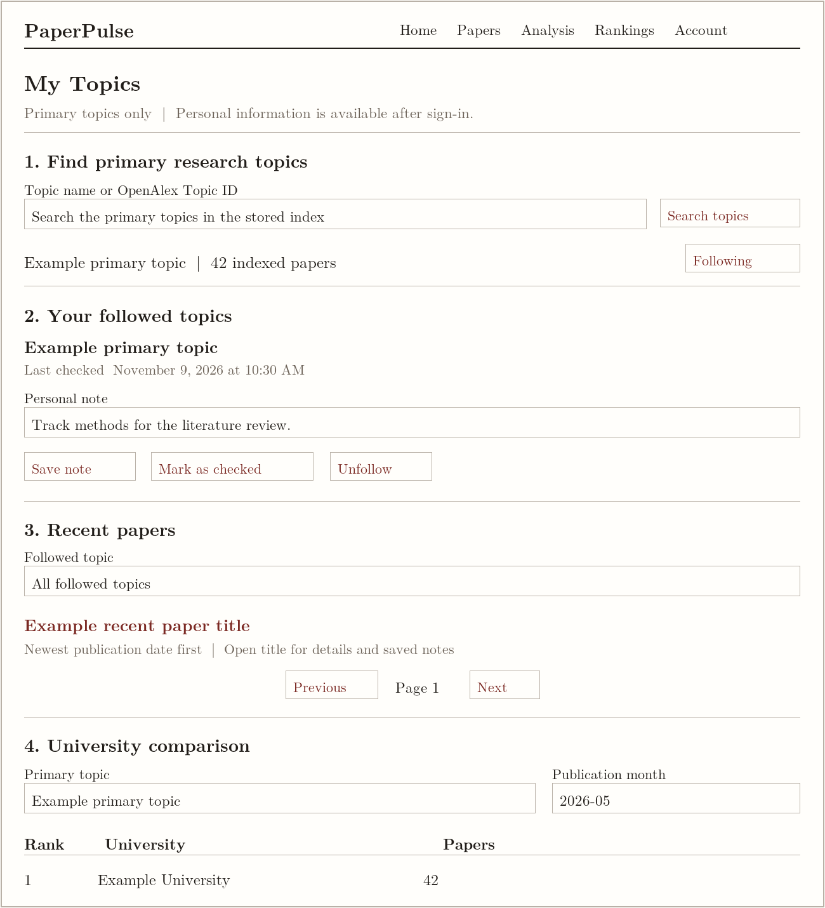
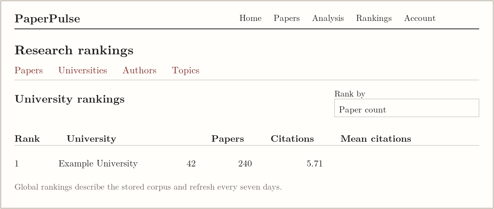
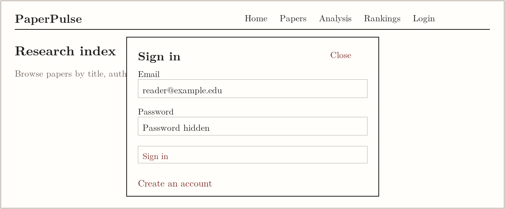

# PaperPulse — Discover and Track University Research

PaperPulse is a full-stack web application that helps students and researchers discover, organize, and track academic research papers published in 2026 by universities in the United States and Canada.

Users can search for research papers, explore university rankings, save papers to personal reading lists, and follow research categories to stay updated on recent publications.

## 1. Authors

- **Sheng Qin** — Paper Discovery, Saved Papers, Authentication, and Research Analytics
- **Tian Yuan** — Research Category Tracker, Followed Topics CRUD, Recent Papers Dashboard, and University Comparison

**Course:** CS 5610 — Web Development

**Course link:** [Add course URL]

**University:** Northeastern University

## 2. Project Objective

The goal of PaperPulse is to provide a centralized platform for exploring and managing university research publications.

The application addresses three main challenges:

- **Research Discovery:** Finding relevant papers across universities, authors, research categories, and publication dates.
- **Research Organization:** Saving interesting papers, maintaining reading notes, and tracking reading progress.
- **Research Monitoring:** Following research categories, discovering newly published papers, and comparing research activity across universities.

PaperPulse focuses on research papers published in 2026 with institutional affiliations in the United States or Canada.

## 3. Key Features

### 3.1 Paper Discovery

- Browse research papers imported from OpenAlex.
- Search papers by title, author, and research category.
- Filter publications by university and publication month.
- Sort papers by cumulative citation count.
- View paper details and publication metadata.

### 3.2 Saved Papers

Authenticated users can manage their personal research reading lists.

- Save papers to a personal collection.
- View saved papers.
- Add and update reading notes.
- Track reading status: Unread, Reading, or Read.
- Remove papers from the saved collection.

### 3.3 Research Category Tracker

Users can follow research topics and monitor publication activity.

- Search and discover research categories.
- Follow selected research categories.
- View and manage followed categories.
- Update or remove followed topics.
- Track when each category was last checked.

### 3.4 Recent Papers Dashboard

- View recently published papers in followed research categories.
- Monitor publication updates for topics of interest.
- Access relevant papers directly from the dashboard.

### 3.5 University Comparison

- Compare universities by the number of papers published.
- Filter comparisons by research category and publication month.
- Explore research activity across institutions.

### 3.6 Research Analytics and Rankings

- Explore publication statistics and research trends.
- View rankings of papers, universities, authors, and research topics.
- Analyze citation distributions and publication activity.

### 3.7 User Authentication

- Register a user account.
- Log in and log out.
- Maintain authenticated sessions using Passport.js.
- Keep saved papers and followed topics associated with individual users.

## 4. Technology Stack

| Layer             | Technologies                                |
| ----------------- | ------------------------------------------- |
| Frontend          | React, React Hooks, JavaScript, HTML5, CSS3 |
| Backend           | Node.js, Express.js                         |
| Database          | MongoDB (Native Node.js Driver)             |
| Authentication    | Passport.js, Express Session                |
| API Communication | Fetch API                                   |
| Research Data     | OpenAlex                                    |
| Testing           | Node.js Test Runner                         |
| Code Quality      | ESLint, Prettier                            |
| Deployment        | Railway                                     |

The application uses client-side rendering with React and communicates with the Express backend through RESTful APIs.

## 5. Project Structure

```text
CS5610-P3/
├── backend/
│   ├── server.js
│   ├── database.js
│   ├── auth.js
│   ├── papers.js
│   ├── saved-papers.js
│   ├── followed-topics.js
│   ├── topics.js
│   ├── topic-input.js
│   ├── rankings.js
│   ├── analysis.js
│   ├── import-openalex.js
│   └── package.json
│
├── frontend/
│   ├── public/
│   ├── src/
│   │   ├── App.jsx
│   │   ├── MyTopicsPage.jsx
│   │   ├── TopicSearch.jsx
│   │   ├── FollowedTopicEntry.jsx
│   │   ├── RecentTopicPapers.jsx
│   │   ├── TopicUniversityComparison.jsx
│   │   └── topicRequest.js
│   └── package.json
│
├── Doc/
│   ├── design-document.md
│   └── design-mockups/
│       ├── login.png
│       ├── papers.png
│       ├── details.png
│       ├── saved.png
│       ├── my-topics.png
│       └── rankings.png
│
├── .gitattributes
├── .gitignore
├── eslint.config.mjs
├── package.json
├── LICENSE
└── README.md
```

## 6. Installation and Setup

### Prerequisites

Before running the application, ensure that the following are available:

- Node.js 22.13 or later within the 22.x release line, and npm
- MongoDB database connection
- Git

### Install from the repository root

```bash
git clone https://github.com/infiniwire/CS5610-P3.git
cd CS5610-P3
npm ci
```

The root npm workspace installs the backend and frontend dependencies from the shared lockfile.

### Configure environment variables

Create a `.env` file in the project root directory.

```env
MONGODB_URI=your_mongodb_connection_string
SESSION_SECRET=your_secure_session_secret
```

The session secret must contain at least 32 bytes. Use a MongoDB connection with access to the
`paperpulse` database. The OpenAlex importer also requires `OPENALEX_API_KEY` when importing data.

**Security:** Never commit the `.env` file or any real credentials to GitHub.

### Run in development

```bash
npm run dev
```

Open the URL printed by Vite, usually `http://localhost:5173`. The root command starts both
workspaces, and Vite proxies API requests to Express on port 3000 by default.

### Build and run

```bash
npm run build
npm start
```

Open `http://localhost:3000`. Express serves the production build from `frontend/dist/` and provides
the REST API endpoints.

## 7. Database

PaperPulse uses MongoDB to store research data and user-specific information.

Major collections include:

| Collection       | Purpose                                                     |
| ---------------- | ----------------------------------------------------------- |
| `papers`         | Research publications and metadata                          |
| `users`          | Registered user accounts                                    |
| `savedPapers`    | User reading lists, notes, and reading status               |
| `followedTopics` | User research interests, notes, and last-checked times      |
| `sessions`       | Passport login sessions                                     |
| `appCache`       | Cached research statistics, rankings, and topic comparisons |

Research publication metadata is imported from OpenAlex.

The application uses the native MongoDB Node.js driver rather than Mongoose.

## 8. Testing and Code Quality

The project includes automated tests for backend functionality and selected frontend utilities.

Test files cover:

- Paper search and query validation.
- Saved paper CRUD and user isolation.
- Followed topic functionality.
- Research topic queries.
- Rankings and analytics.
- Dataset summary and caching.
- Frontend topic request utilities.

The project uses ESLint for code quality and Prettier for consistent formatting.

Run the checks from the repository root.

```bash
npm run check
npm run build
npm test
```

To include both MongoDB integration suites, load the root `.env` when running the tests.

```bash
node --env-file=.env --test backend/*.test.js frontend/src/*.test.js
```

The integration suites create and clean up separate test databases. The MongoDB connection used
for testing needs permission to create and drop those databases.

## 9. Design Documentation

The project design document includes:

- Project description
- User personas
- User stories
- Design mockups

See [Design Document](Doc/design-document.md).

### Design Mockups

**Paper Discovery**



**Paper Details**



**Saved Papers**



**Research Category Tracker**



**Research Rankings**



**Login**



## 10. Deployment

**Live Application:** [PaperPulse on Railway](https://paperpulse.up.railway.app/)

**Presentation Slides:** [PaperPulse on Google Slides](https://docs.google.com/presentation/d/1-Wb3bF-cQ0_Dj9BkOcp4qgJsg0uFDE2gsVt0IWQt-4c/edit?usp=sharing)

**Demo Video:** [Add public narrated demonstration URL]

The application is designed to be deployed on Railway, with Express serving the React production build and MongoDB providing persistent data storage.

## 11. License

PaperPulse source code is available under the [MIT License](LICENSE).

## 12. Acknowledgments

- **OpenAlex** — Research publication metadata.
- **Northeastern University CS 5610** — Course project guidance.
